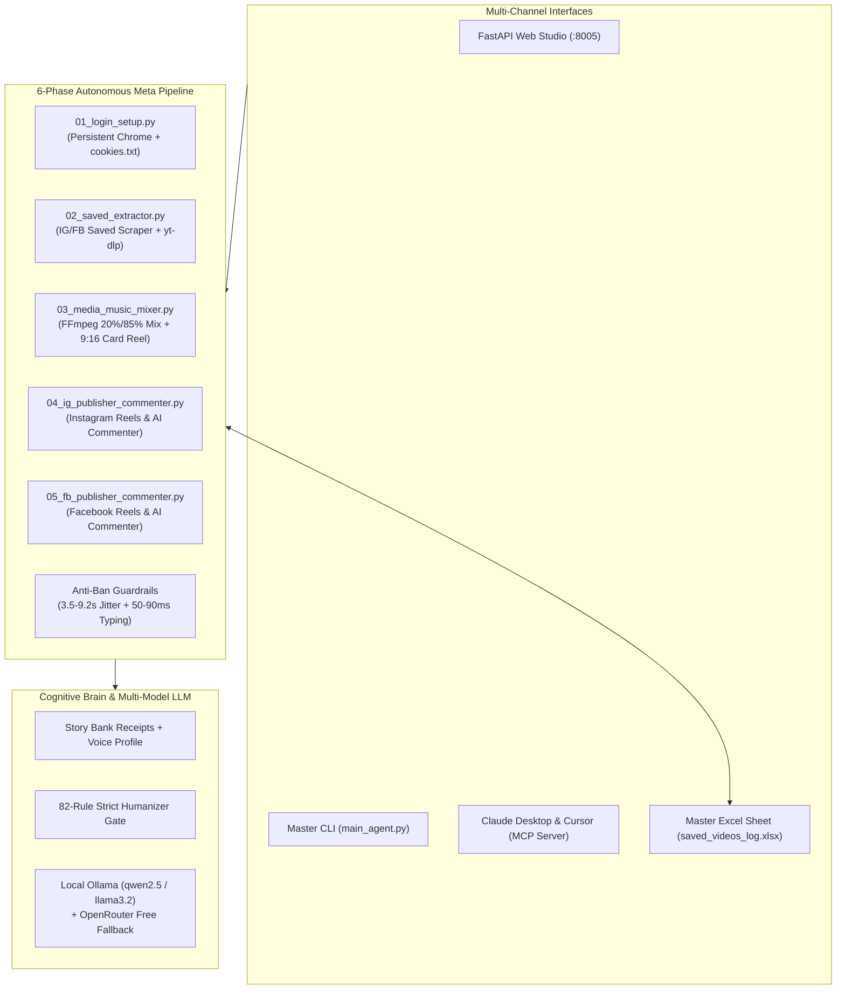

# 🎬 Meta Nexus Agent — Zero-API Facebook & Instagram Autonomous Studio

<p align="center">
  <a href="https://github.com/muhdfaisalwork-gif/meta-agent/actions"></a>
  <a href="https://modelcontextprotocol.io/"></a>
  <a href="https://ollama.com/"></a>
  <a href="https://github.com/yt-dlp/yt-dlp"></a>
  <a href="https://ffmpeg.org/"></a>
  <a href="https://playwright.dev/"></a>
  <a href="#license"></a>
</p>

<p align="center">
  <b>The #1 Free, Open-Source Zero-API Alternative to Hootsuite, Later & ManyChat for Facebook & Instagram.</b><br>
  Powered by <b>Playwright Persistent Chrome Context</b>, <b>yt-dlp</b>, <b>FFmpeg Audio Studio</b>, an <b>Automated Excel Master Sheet (`saved_videos_log.xlsx`)</b>, an <b>82-Rule Humanizer Gate</b>, <b>Local Ollama</b>, and native <b>Claude / Cursor MCP Server</b> support.
</p>

---

## ⚡ Why Meta Nexus Agent?

Paid social media schedulers and comment automation tools charge **$49 to $199/month**, force you through brittle Meta Graph API approvals, strip trending audio tracks, and generate detectable AI slop that destroys Reel retention.

**Meta Nexus Agent solves this 100% locally with zero API fees:**
1. **Persistent Login Engine (`chrome_profile`)**: Log into Instagram and Facebook manually once (or inject `sessionid` / `c_user`+`xs` cookies in `< 1s`). Exports decrypted Netscape `cookies.txt` so `yt-dlp` never hits Windows Chrome DPAPI locks.
2. **Saved Video Extractor & `yt-dlp` Downloader (`02_saved_extractor.py`)**: Scrapes your Instagram Saved (`/saved/all-posts/`) and Facebook Saved (`/saved`) collections, downloads high-resolution `.mp4` Reels via `yt-dlp`, and extracts full metadata (Title/Hook, Caption, Creator Handle, Duration, Audio Track).
3. **Automated Master Sheet (`saved_videos_log.xlsx`)**: Bidirectionally syncs every scraped, mixed, and published Reel between a styled Excel workbook and local SQLite (`storage/meta_agent.db`).
4. **FFmpeg Music & Reel Studio (`03_media_music_mixer.py`)**:
   - **Scenario A (Reel + Local MP3 Pre-Mix)**: Lowers original video audio to `20%` and overlays `.mp3` tracks from `music_library/` at `85%` volume.
   - **Scenario B (Static Image + Music -> 15s Reel)**: Loops any `.jpg/.png` or auto-generated `1080x1920` (`9:16`) builder quote card with an `.mp3` track into a 15-second vertical Reel.
   - **Scenario C (Native Platform Audio)**: Flags rows with `NATIVE_UI:<song_name>` so the Playwright uploader selects trending music directly inside Instagram/Facebook's native "Add Music" UI modal.
5. **82-Rule Humanizer & Cognitive Brain**: Eliminates all 82 AI buzzwords (*delve, tapestry, robust, pivotal, game-changer, landscape*) and grounds captions and comment replies in verified project receipts from your Story Bank.
6. **Autonomous IG & FB Publishers + AI Comment Engine (`04_ig` & `05_fb`)**: Publishes Reels/Posts and runs **Mode 1 (Inbox/Comment Auto-Reply)** and **Mode 2 (Niche Hashtag Outreach)** with `3.5s–9.2s` human jitter, `5–8s` Reel watch simulation, and `50–90ms` per-character keystroke typing.

---

## 📊 Comparison: Meta Nexus Agent vs. Paid SaaS

| Feature | **Meta Nexus Agent** | **Hootsuite / Buffer** | **Later** | **ManyChat** |
| :--- | :---: | :---: | :---: | :---: |
| **Price** | **$0 / month (Free & Open Source)** | $99 – $249 / mo | $25 – $80 / mo | $15 – $145 / mo |
| **Meta Graph API Required?** | **✓ Zero-API (Persistent Browser + Cookie)** | ❌ Requires Business API | ❌ Requires API | ❌ Requires Webhooks |
| **Saved Reels `yt-dlp` Downloader** | **✓ Built-in (`chrome_profile/cookies.txt`)** | ❌ No | ❌ No | ❌ No |
| **FFmpeg 20%/85% Audio Mixer** | **✓ Built-in (Scenarios A, B & C)** | ❌ No | ❌ No | ❌ No |
| **Automated Excel Master Sheet** | **✓ Live `saved_videos_log.xlsx` Sync** | ❌ CSV export only | ❌ No | ❌ No |
| **Local Offline AI (Ollama)** | **✓ Yes (`qwen2.5` / `llama3.2` / `deepseek-r1`)** | ❌ Cloud only | ❌ Cloud only | ❌ Cloud only |
| **82-Rule Anti-Slop Humanizer** | **✓ Strict 4-Pass Programmatic Scrub** | ❌ Generic AI | ❌ Generic AI | ❌ Flow templates |
| **Claude Desktop / Cursor MCP** | **✓ Native JSON-RPC 2.0 Server** | ❌ No | ❌ No | ❌ No |

---

## 🏗️ System Architecture



---

## 📁 Directory & File Architecture

```text
G:\Meta agent\
│
├── chrome_profile\              # Persistent Chrome user data (FB & IG cookies + Netscape cookies.txt for yt-dlp)
├── saved_videos\                # Downloaded raw .mp4 files from FB & IG Saved collections
│   ├── instagram\
│   └── facebook\
├── music_library\               # Local .mp3 songs/audio tracks to attach to Posts & Reels
├── ready_to_post\               # Final processed 1080x1920 Reels & Image-Music videos ready for upload
├── logs\                        # Error logs and execution history
├── storage\                     # Local SQLite database (meta_agent.db) synced with Excel
│
├── saved_videos_log.xlsx        # Master spreadsheet (ID, Platform, Hook, Caption, Creator, URL, MP4, Music, Status, Posted URL)
├── config.json                  # Usernames, posting schedules, human-delay timings, Ollama model name
│
├── 01_login_setup.py            # Phase 1: Run ONCE to log into Facebook & Instagram manually (or inject cookies)
├── 02_saved_extractor.py        # Phase 2: Scrapes Saved posts, downloads videos via yt-dlp, updates Excel sheet
├── 03_media_music_mixer.py      # Phase 3: FFmpeg engine to combine music + video or static image + music
├── 04_ig_publisher_commenter.py # Phase 4 & 5: Playwright UI automation for Instagram Reels, Posts & Comments
├── 05_fb_publisher_commenter.py # Phase 4 & 5: Playwright UI automation for Facebook Reels, Posts & Comments
├── main_agent.py                # Master CLI / AI controller that orchestrates all modules
├── run.py                       # FastAPI Web Studio Dashboard launcher (:8005)
├── run_mcp.py                   # Model Context Protocol (MCP) Server for Claude Desktop & Cursor
└── launch.bat                   # 1-Click Windows Studio Launcher
```

---

## 🚀 Quick Start (Up in < 2 Minutes)

### Option A: 1-Click Launch (Windows)
Double-click `launch.bat` in the repository root:
```cmd
launch.bat
```

### Option B: Terminal / Python (All Platforms)
```bash
# Clone the repository
git clone https://github.com/muhdfaisalwork-gif/meta-agent.git
cd meta-agent

# Install dependencies
pip install -r requirements.txt
playwright install chromium

# Launch Web Studio Server (http://localhost:8005)
python run.py
```

---

## 🛠️ Running the 6 Blueprint Modules via CLI

```bash
# Phase 1: Log into Instagram (Tab 1) & Facebook (Tab 2) once in persistent Chrome
python 01_login_setup.py

# Phase 2: Scrape Saved Reels/Videos via yt-dlp & update saved_videos_log.xlsx
python 02_saved_extractor.py --platform both --max 5

# Phase 3 (Scenario A): Batch mix downloaded Reels with local MP3s (20% original / 85% music)
python 03_media_music_mixer.py --scenario batch

# Phase 3 (Scenario B): Turn a 9:16 quote card / static image + MP3 into a 15s 1080x1920 Reel
python 03_media_music_mixer.py --scenario b --hook-text "How we cut order execution latency from 1.2s to 420ms"

# Phase 4 & 5: Publish Reels & Auto-Reply to Comments on Instagram and Facebook
python 04_ig_publisher_commenter.py --action publish
python 04_ig_publisher_commenter.py --action auto-reply
python 05_fb_publisher_commenter.py --action publish
python 05_fb_publisher_commenter.py --action auto-reply

# Run Full End-to-End Autonomous Cycle
python main_agent.py --auto
```

---

## 🔌 Connect to Claude Desktop or Cursor (MCP)

Meta Nexus Agent includes a certified **Model Context Protocol (MCP 2024-11-05)** server:

```bash
python scripts/install_mcp.py
```

Or add manually to `claude_desktop_config.json`:
```json
{
  "mcpServers": {
    "meta-nexus": {
      "command": "python",
      "args": ["G:\\Meta agent\\run_mcp.py"]
    }
  }
}
```

---

## 🧪 Automated Test Suite (100% Pass Rate)

```bash
python -m pytest -v
```

---

## 🤝 Contributing & Security

Contributions are warmly welcomed! Please read [CONTRIBUTING.md](CONTRIBUTING.md) and review [SECURITY.md](SECURITY.md).

---

## 📄 License

Distributed under the MIT License. See [LICENSE](LICENSE) for full details.
